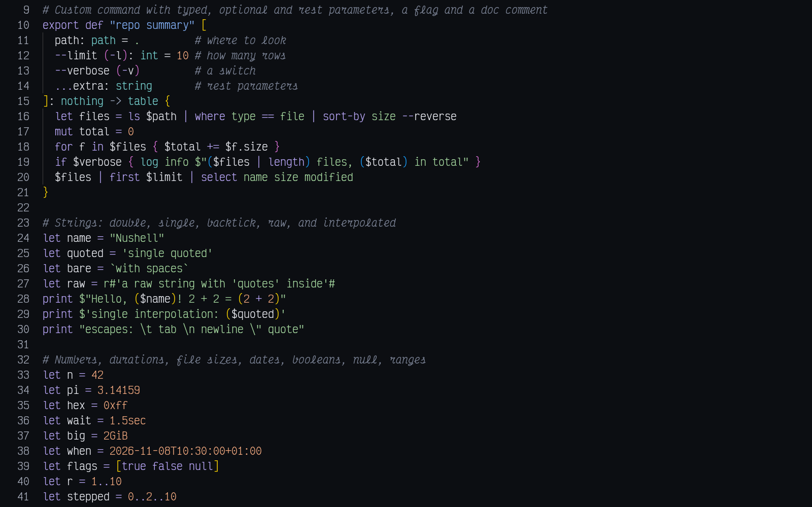

# Nushell syntax for Orca

Nushell syntax highlighting for [Orca](https://www.onorca.dev): `.nu` scripts and `.nuon` data files.



## What it adds

- Highlighting for `.nu` and `.nuon` files in Orca's editor.
- Comment toggling with `#`, bracket matching, and auto-closing brackets and quotes.

It is a data plugin: it runs no code, and installs in one click.

## Install

Needs Orca 1.4.246 or newer.

```sh
orca plugin install ChristianLemer/orca-nushell-syntax
```

Its page in Orca's plugin directory is
[onorca.dev/plugins/ChristianLemer/orca-nushell-syntax](https://www.onorca.dev/plugins/ChristianLemer/orca-nushell-syntax).

It installs as `christianlemer.nushell-syntax`, and colors every open `.nu` and `.nuon` file at
once, without a reload. To remove it: `orca plugin uninstall christianlemer.nushell-syntax`.

## Limits

- It colors and nothing more: no completions, diagnostics or go-to-definition.
- `.nuon` files are colored with the same grammar as scripts. There is no separate NUON
  grammar.
- Orca's own limits apply, as for every grammar: from a line longer than 1,000 characters the
  rest of the file stays plain, and so does a whole file over 500,000 characters or 20,000
  lines.

## Reporting a problem

The grammar is upstream's, unchanged. If a color is wrong in VS Code with the Nushell extension
too, the fix belongs in
[nushell/vscode-nushell-lang](https://github.com/nushell/vscode-nushell-lang/issues). For
anything else, [open an issue here](https://github.com/ChristianLemer/orca-nushell-syntax/issues)
with the line that shows it. [CONTRIBUTING.md](CONTRIBUTING.md) says how to check a change.

## Credits

The grammar is `syntaxes/nushell.tmLanguage.json` from
[nushell/vscode-nushell-lang](https://github.com/nushell/vscode-nushell-lang), by the Nushell
Project Developers, under the MIT license. It is copied unchanged, currently from
upstream commit `ffd0e93105a9bad1303583a43f47eae7d0e34dab`.
This plugin packages it for Orca; `scripts/sync-grammar.nu` brings it in step with upstream.

## License

MIT. See [LICENSE](LICENSE). The grammar keeps its own MIT notice, in
[syntaxes/nushell-LICENSE.txt](syntaxes/nushell-LICENSE.txt).

Changes between versions are in [CHANGELOG.md](CHANGELOG.md).
